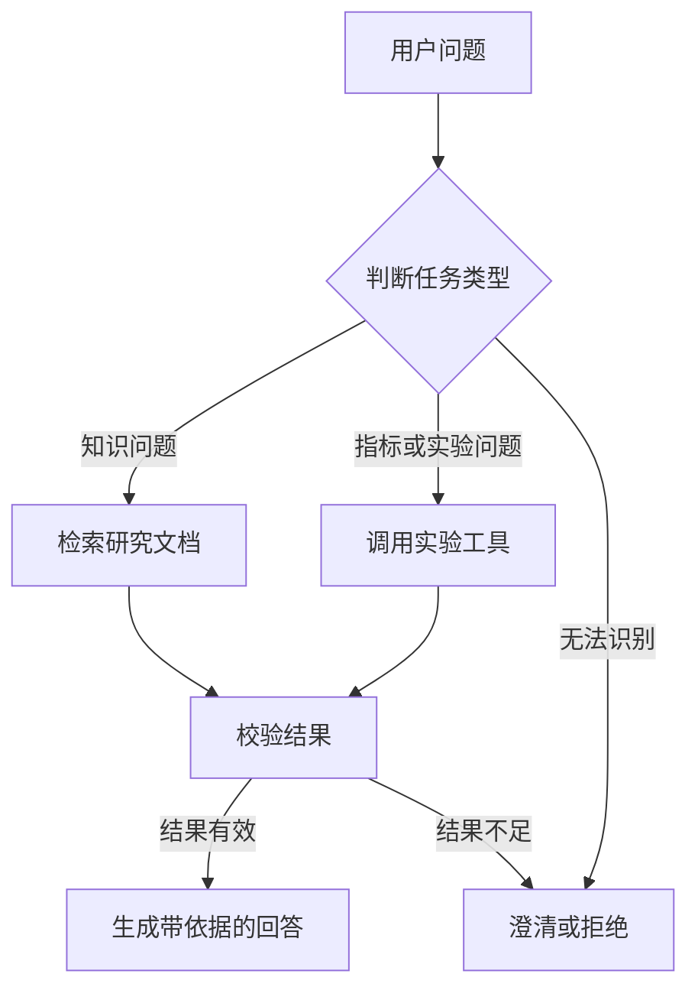

# SignalLab Agent 架构设计

## 1. 项目目标

SignalLab Agent 是面向通信信号与神经谱分析场景的智能助手。

系统需要根据用户问题，自动选择知识库检索或实验数据工具，
并根据返回结果生成带有依据的回答。

系统主要支持以下任务：

1. 查询模型和多窗口 FFT 的相关知识；
2. 查询模型实验指标；
3. 比较不同模型的实验结果；
4. 查询实验配置；
5. 生成实验指标图；
6. 在缺少可靠依据时拒绝回答或要求用户补充信息。

---

## 2. Agent核心组成

| 组成部分 | 在本项目中的职责 |
|---|---|
| LLM | 理解问题、判断任务、选择工具、生成答案 |
| Planning | 将复杂问题拆成多个可执行步骤 |
| Tools | 执行知识检索、指标查询、模型比较和绘图 |
| Memory | 保存对话历史、工具结果和任务状态 |
| Observation | 保存工具执行后返回的结果 |
| Validation | 检查工具结果是否完整、可靠和可引用 |

---

## 3. 系统已有能力

当前已经完成以下基础模块：

1. LLMClient；
2. FastAPI基础接口；
3. 文档读取、清洗和切分；
4. Embedding模型；
5. Chroma向量库；
6. Dense检索；
7. BM25检索；
8. Hybrid混合检索；
9. Reranker；
10. RAG Pipeline；
11. 检索效果评估。

这些模块目前是Agent可以利用的底层能力，
但还没有正式注册成Agent工具。

---

## 4. 计划提供的工具

| 工具名称 | 输入 | 输出 | 用途 |
|---|---|---|---|
| search_research_docs | question、top_k | 文档片段和来源 | 查询研究文档 |
| get_model_metrics | model、metric、group | 指标数据 | 查询单个模型指标 |
| compare_models | model_a、model_b、metric、group | 对比结果 | 比较两个模型 |
| get_experiment_config | experiment_id | 实验配置 | 查询实验参数 |
| generate_metric_plot | models、metric、group | 图片路径 | 生成指标图 |

以上工具将在后续任务中实现，
本文件目前只定义系统设计。

---

## 5. Agent整体流程



---

## 6. 任务路由设计

### 6.1 知识问答

示例：

- 多窗口FFT有什么作用？
- FFT参考是否直接作为网络输出？
- 模型输入数据是什么？

处理方式：

```text
用户问题
→ search_research_docs
→ Hybrid Retrieval
→ 检查来源
→ LLM生成答案
→ 返回答案和来源
```

### 6.2 实验指标查询

示例：

- NCSD-Net的hit rate是多少？
- 某模型在低信噪比下表现怎么样？

处理方式：

```text
用户问题
→ get_model_metrics
→ 查询实验数据
→ 校验字段
→ 返回指标和实验条件
```

### 6.3 模型比较

示例：

- 比较NCSD-Net和TFA-Net在低信噪比下的hit rate。

处理方式：

```text
用户问题
→ 提取模型、指标和分组
→ compare_models
→ 获得两个模型的指标
→ 计算或组织比较结果
→ 返回结论
```

### 6.4 绘图任务

示例：

- 画出NCSD-Net和TFA-Net的hit rate对比图。

处理方式：

```text
用户问题
→ 查询实验指标
→ 校验数据
→ generate_metric_plot
→ 返回图表路径和数据说明
```

---

## 7. 检索策略

当前知识库较小，已有评测结果为：

| 指标 | Hybrid | Hybrid+Reranker |
|---|---:|---:|
| Recall@1 | 0.6250 | 0.2500 |
| Recall@3 | 1.0000 | 1.0000 |
| MRR@3 | 1.0000 | 0.7500 |
| 平均延迟 | 662.68 ms | 1325.24 ms |

因此当前设计选择：

1. 默认使用Hybrid混合检索；
2. Reranker暂时作为可选能力；
3. 不默认对所有问题进行重排；
4. 知识库扩大后重新评测；
5. 是否启用Reranker必须由真实评测结果决定。

---

## 8. 结果校验规则

### 8.1 RAG结果校验

需要检查：

1. 是否检索到文档；
2. 是否具有chunk_id；
3. 是否保留metadata；
4. 是否达到最低相关性要求；
5. 答案是否可以由检索内容支持。

如果没有可靠依据：

```text
当前知识库中没有找到足够信息，无法可靠回答该问题。
```

### 8.2 工具结果校验

需要检查：

1. 工具是否执行成功；
2. 返回值是否为空；
3. 必要字段是否存在；
4. 指标名称是否合法；
5. 模型名称是否存在；
6. 实验条件是否完整。

### 8.3 错误处理

出现错误时：

1. 参数格式错误：允许修正后重试；
2. 工具不存在：返回工具不存在错误；
3. 工具执行失败：记录错误信息；
4. 多次失败：停止循环；
5. 数据不足：要求用户补充信息；
6. 涉及危险操作：要求人工确认。

---

## 9. Memory设计

后续AgentState计划保存：

- user_question：用户问题；
- task_type：任务类型；
- plan：当前执行计划；
- tool_calls：工具调用记录；
- observations：工具返回结果；
- retrieved_chunks：检索结果；
- errors：错误信息；
- final_answer：最终回答。

Memory将在后续LangGraph任务中正式实现，
今天只完成字段设计。

---

## 10. 系统边界

Agent可以自动执行：

- 查询知识库；
- 查询实验指标；
- 比较模型；
- 读取实验配置；
- 生成只读图表。

Agent不能未经确认执行：

- 删除文件；
- 覆盖实验结果；
- 修改原始数据；
- 启动训练任务；
- 执行来源不明的代码；
- 上传未公开论文或专利内容。

---

## 11. 当前状态与后续任务

当前状态：

- RAG基础模块已经完成；
- 检索评测已经完成；
- Agent架构设计已经完成；
- Agent工具尚未正式实现；
- Agent循环尚未实现；
- Memory尚未实现；
- LangGraph工作流尚未实现。

后续计划：

1. Day 18：实现原生Agent循环；
2. Day 19：实现五个真实工具；
3. Day 20：完善工具注册、参数校验和错误处理；
4. Day 21：接入LangChain；
5. Day 22：接入LangGraph；
6. Day 23：实现State与Memory；
7. Day 24：实现错误恢复与人工确认。